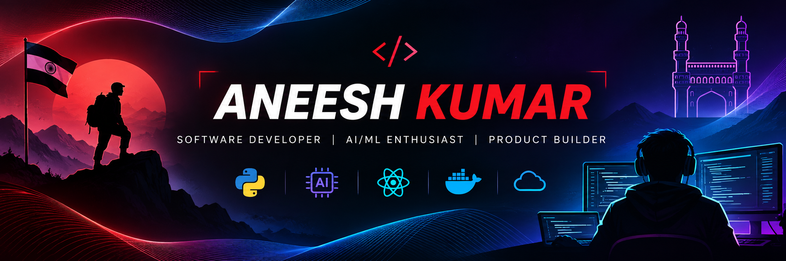

<div align="center">
  
</div>


   **Building practical software. Exploring intelligent systems. Turning ideas into products.**

<a href="https://github.com/Aneesh-kumar-89">
  
</a>
<a href="https://youtube.com/@aneesh-c7s">
  
</a>

</div>

---

## `whoami`

I'm a Computer Science and Engineering graduate interested in building useful software products with Python, AI/ML, automation, and modern web technologies.

I enjoy taking an idea from problem discovery and technical planning through implementation, testing, and deployment. My focus is on practical applications that solve real problems—not technology for its own sake.

```python
aneesh = {
    "role": "Software Developer",
    "education": "B.Tech — Computer Science and Engineering",
    "interests": [
        "Python Development",
        "Artificial Intelligence & Machine Learning",
        "Generative AI",
        "Full-Stack Applications",
        "Automation",
        "SaaS & Product Engineering",
    ],
    "currently_building": ["InvoiceIQ"],
    "mindset": "Learn • Build • Test • Improve",
}
```

---

## Featured Project

### 🧾 [InvoiceIQ](https://github.com/Aneesh-kumar-89/InvoiceIQ)

**AI-powered invoice processing and management platform**

A full-stack application designed to streamline invoice workflows through OCR-based extraction, structured data handling, validation, reconciliation, supplier management, and reporting.

**Technology:** Python · FastAPI · React · TypeScript · PostgreSQL · Docker

**Stage:** Functional MVP / Prototype

---

### 🎓 SPARKS — Student AI Chatbot and Academic Analyzer

An academic assistant concept focused on helping students navigate learning resources and study workflows.

Planned and developed capabilities include:

- Retrieval-augmented question answering over learning materials
- PDF-based contextual question answering
- Syllabus comparison and resource recommendations
- Test preparation and reminders
- Personalized learning support

**Technology explored:** Python · Sentence Transformers · FAISS · PyTorch · Hugging Face · React

---

## Technical Skills

<div align="center">

### Languages & Backend


### Frontend & Web


### AI / ML & Data


### Tools & Deployment


</div>

---

## Beyond Development

- **Content creation:** I run [Aneesh | Practical Python](https://youtube.com/@aneesh-c7s), a channel focused on practical programming learning.
- **Video editing:** Canva and Clipchamp.
- **Languages:** English · Hindi · Telugu.

---

## Current Focus

- Building and documenting functional software products.
- Strengthening Python, backend engineering, and AI/ML skills.
- Learning reliable deployment and production practices.
- Exploring opportunities to turn useful prototypes into sustainable products.

---

## Connect

<div align="center">

[](https://github.com/Aneesh-kumar-89)
[](https://youtube.com/@aneesh-c7s)

**Build with purpose. Improve with every iteration.**

</div>


<div align="center">

</div>
